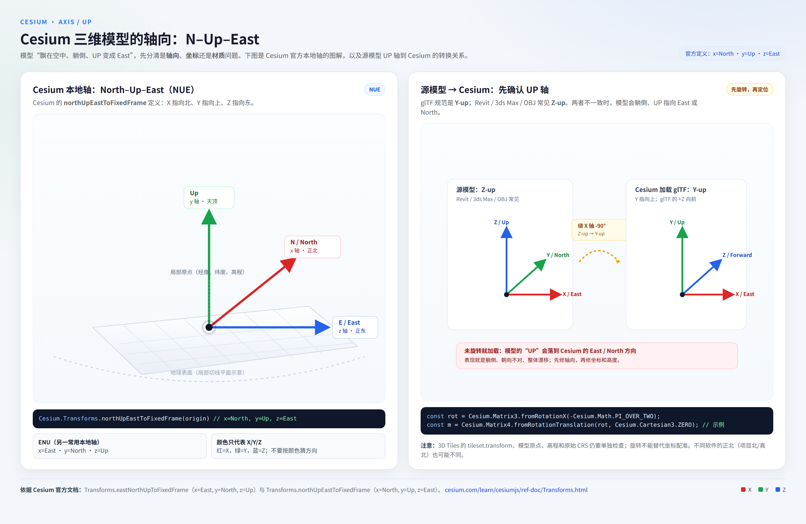

# 三维模型

> 三维模型的标准流程是  确认原始格式与 UP 轴 => 转成 Cesium 可用的格式/3D Tiles => 配准坐标与高度 => 检查材质/颜色 => 预览验收
> 成败的关键在"先轴向、再坐标、最后材质"——三件事混在一起调，越调越乱

从 Revit、3ds Max、OBJ 或 MapGIS HDB 接入 Cesium 时，常见三类现象：

* **模型飘在空中、躺倒、UP 变成 East/North**：轴向、原点或高度问题。
* **模型整体偏移**：原始坐标系/配准问题。
* **模型变黑、不显示**：材质、法线、样式或加载路径问题。

先分清现象，再按本文顺序排查。

## 一、先看 Cesium 的 N–Up–East 轴


*图：依据 Cesium 官方 NUE/ENU 定义绘制的轴示意图，以及 Z-up 模型到 Y-up 的旋转关系。*

Cesium 官方提供两种常用本地轴：

| 本地轴 | x | y | z | 官方方法 |
| :----- | :--- | :--- | :--- | :------- |
| **NUE**（North–Up–East） | North（北） | **Up（上）** | East（东） | [`Transforms.northUpEastToFixedFrame`](https://cesium.com/learn/cesiumjs/ref-doc/Transforms.html#.northUpEastToFixedFrame) |
| **ENU**（East–North–Up） | East（东） | North（北） | **Up（上）** | [`Transforms.eastNorthUpToFixedFrame`](https://cesium.com/learn/cesiumjs/ref-doc/Transforms.html#.eastNorthUpToFixedFrame) |

关键点：

* **NUE 的 y 是 Up，不是 North**；看到"UP 变成了 East"，本质是模型的 UP 轴被映射到了错误的轴。
* Cesium 世界坐标是 ECEF；本地轴只用于把模型放到某个经纬度/高程点。
* [glTF 规范](https://registry.khronos.org/glTF/specs/2.0/glTF-2.0.html)是 **Y-up**；Revit、3ds Max、OBJ 常见 **Z-up**。源模型的 UP 轴与 Cesium/glTF 不一致时，必须旋转。
* 3D Tiles 还要看 `tileset.json` 的 `root.transform`/`transform`，不要只靠"旋转 90°"猜。

## 二、模型飘在空中 / 躺倒 / UP 变 East

先判断属于哪一种：

| 现象 | 更可能是 | 先做什么 |
| :--- | :------- | :------- |
| 模型躺倒、UP 指向 East/North | 源模型 Z-up，Cesium/glTF 按 Y-up 解释 | 确认源 UP 轴，绕 X 轴旋转 -90° |
| 模型整体悬空/埋地 | 原点、高程或 `modelMatrix` 平移错 | 检查模型原点、包围球中心、`height` |
| 模型整体偏移几百米~几公里 | 原始 CRS/配准错（高斯、CGCS2000、无地理坐标） | 先转 4326/4978，再做 3D Tiles |
| 模型镜像/朝向相反 | 轴序/负缩放/左右手系不一致 | 检查 `scale` 符号和轴序 |
| 只有一部分可见 | 包围盒/裁剪/缩放/瓦片加载 | 查 `tileset.json`、`boundingVolume`、`maximumScreenSpaceError` |

### 2.1 先确认原始 UP 轴

不要凭扩展名猜：

* **Revit（RVT）**：常见 Z-up；导出 OBJ/glTF 时看导出器是否做了 Y-up 转换。
* **3ds Max**：Z-up。
* **OBJ**：本身没有统一轴规范，取决于导出软件；常见 Z-up。
* **glTF/GLB**：Y-up，+Z 为前方。
* **3D Tiles**：看 `tileset.json` 的 `transform` 和内容类型；不要把 3D Tiles 的瓦片坐标直接当成经纬度。

最稳的办法：在原始软件里确认"哪根轴朝天"，再问导出器是否转换。**不同的模型软件"正北"也不一样**（项目北/真北/世界北），朝向问题不能只靠旋转 UP 轴解决。

### 2.2 旋转：Z-up → Y-up

```js
const center = Cesium.Cartesian3.fromDegrees(lon, lat, height); // 模型落点
const enu = Cesium.Transforms.eastNorthUpToFixedFrame(center);

// Z-up -> Y-up：绕 X 轴 -90°
const rotX = Cesium.Matrix3.fromRotationX(-Cesium.Math.PI_OVER_TWO);
const rot4 = Cesium.Matrix4.fromRotationTranslation(rotX, Cesium.Cartesian3.ZERO);

// 先旋转，再平移到落点
const modelMatrix = Cesium.Matrix4.multiply(enu, rot4, new Cesium.Matrix4());

const model = await Cesium.Model.fromGltfAsync({
  url: '/models/building.glb',
  modelMatrix,
});
viewer.scene.primitives.add(model);
```

**先确认导出器是否已经转换**：如果 OBJ/glTF 导出时已经把 Z-up 转成 Y-up，页面不要再转；只有原始顶点仍是 Z-up 时才用上面的 `rotX`。判断方法：不加任何旋转先看模型是否躺倒，或检查导出器的 axis/up 设置。

3D Tiles 的写法类似，但**先确认是否已经带 `root.transform`**：

```js
const tileset = await Cesium.Cesium3DTileset.fromUrl('/tiles/tileset.json');
// 仅当 tileset 是局部坐标、且没有 root.transform 时这样叠加；
// 已是 ECEF/4978 的 tileset 不要再加 modelMatrix。
tileset.modelMatrix = Cesium.Matrix4.multiply(enu, rot4, new Cesium.Matrix4());
viewer.scene.primitives.add(tileset);
```

### 2.3 原点与高度：漂浮不一定是轴的问题

轴向正确但模型悬空，通常是：

* 模型原点在建筑底部、中心或世界原点，和落点高程不一致；
* 3D Tiles 里已经带了世界坐标，页面又叠了一次 `modelMatrix`；
* 用了 `heightReference` 但模型不是 Entity，或者地面高程不可靠；
* 原始数据没有高程，转换时被默认成 0，导致模型贴地/埋地。

处理顺序：

1. 用 `3dtiles_cli inspect tileset` 看 `boundingVolume`、`transform` 和内容类型。
2. 确认模型局部原点（包围球中心）与落点的关系。
3. 调整 `height` 或 `modelMatrix` 的平移，不要先改相机。
4. 如果坐标系本身不对，先回到[空间参考系](/docs/spatial-crs)处理 CRS，再做高度。

### 2.4 `Cesium.Matrix3.fromColumns` 报错

这个报错不是模型问题，是 **Cesium 版本/API 用错**。

产品固定使用 **Cesium 1.122**，1.122 的 `Matrix3` 没有 `fromColumns` 方法。可用的写法：

```js
// 用列主序数组
const m3 = Cesium.Matrix3.fromColumnMajorArray([
  1, 0, 0,
  0, 0, -1,
  0, 1, 0,
]);

// 或者直接用旋转构造
const rotX = Cesium.Matrix3.fromRotationX(-Cesium.Math.PI_OVER_TWO);
```

相关 API 以官方文档为准：[`Matrix3.fromColumnMajorArray`](https://cesium.com/learn/cesiumjs/ref-doc/Matrix3.html#.fromColumnMajorArray)、[`Matrix3.fromRotationX`](https://cesium.com/learn/cesiumjs/ref-doc/Matrix3.html#.fromRotationX)。

不要为了一个方法去升级 Cesium；也不要照抄 1.123+ 的示例。页面里出现 `is not a function`，先检查是不是用了 1.122 不存在的接口。

## 三、模型变黑 / 不显示

### 3.1 变黑

按概率排查：

* **法线缺失或翻转**：没有 `NORMAL` 或法线朝内，光照下就是黑的；在建模软件里重算法线/翻面。
* **材质本身就是黑色**：glTF 的 `baseColorFactor`、OBJ 的 `.mtl`、顶点色为黑；先看原始材质。
* **贴图路径丢失**：OBJ 的 `.mtl`/贴图没有一起导出，或相对路径断了；`3dtiles_cli convert` 会读同目录/相对路径的 `.mtl` 和 diffuse 贴图，保持目录结构。
* **前端样式覆盖**：`tileset.style.color` / `Cesium3DTileStyle` 把颜色改黑；先移除自定义 style 验证。
* **光照/环境**：Cesium 默认光照下纯黑材质不会变亮；需要材质有非零 baseColor 和正确法线。

### 3.2 不显示

* `tileset.json`/`.glb` 路径 404，或只加载了目录而不是 `tileset.json`。
* `modelMatrix` 出现 `NaN`/0 缩放，或模型被移到相机外。
* `maximumScreenSpaceError` 过大/过小、`boundingVolume` 错误、瓦片被裁剪。
* 模型在相机背后/地下，或 `show=false`。
* 点云点太小/颜色透明，看起来"没有"。

先用 `3dtiles_cli inspect tileset` 确认入口、content 类型、包围盒和 transform；再看 F12 Network 是否有 404。

### 3.3 401 与 404 不要归因到模型

* **401**：常见是天地图 tk 过期/限频。F12 → Network 找到 401 的 URL；如果是 `tianditu.gov.cn`，换 tk 或申请新 tk。不是模型轴向问题。
* **404**：`tileset.json`、`.glb`、`.pnts` 路径不对；检查发布目录和相对路径。
* **502/503/504**：模型服务/网络问题，先重试或换网络，不要改模型。

## 四、位置偏移：高斯、CGCS2000、无地理坐标

"模型姿态对了，但整体偏移"通常是坐标问题，不是轴向问题。

| 原始数据 | 处理 |
| :------- | :--- |
| 高斯投影（如 CGCS2000 3 度带 39，EPSG:4527） | 转 4326/4978；`3dtiles_cli convert --srs-in EPSG:4527 --srs-out 4978 --pyproj-always-xy` |
| CGCS2000 经纬度（EPSG:4490） | 按 4326 处理，输出 4978；Web 精度下可视为一致 |
| 经纬度（EPSG:4326） | `--srs-out 4978 --pyproj-always-xy` |
| 无地理坐标 | 提供控制点/局部原点/落点经纬度；不要猜，旋转也救不了 |
| 已是 ECEF/4978 | 不要再叠 `modelMatrix`，否则会二次偏移 |

```bash
# 高斯 CGCS2000 3 度带 39 -> 3D Tiles（ECEF/4978）
3dtiles_cli convert building.obj --out building_tiles \
  --srs-in EPSG:4527 --srs-out 4978 --pyproj-always-xy \
  --spec-version 1.1 --jobs 1 --execute --allow-write --compact

# 检查产物：入口、content 类型、boundingVolume、transform
3dtiles_cli inspect tileset building_tiles/tileset.json --limit 20 --compact
```

原则：**CRS、投影、局部原点、分块尽量在 `3dtiles_cli` 生成阶段解决**，Cesium 页面不要承载坐标修正逻辑。若 `tileset.json` 的包围盒还是百万米级原始投影大坐标，回到生成阶段输出局部居中或 4978，不要在页面里硬调相机/裁剪面。

## 五、建筑精模与树木点云要分开

对话里的"建筑模型灰色 #B4B4B4、植物点云绿色 #228B22"是两类数据，不要塞进同一条管线：

| 对象 | 内容 | 推荐格式/管线 | 颜色/材质 |
| :--- | :--- | :------------ | :-------- |
| 建筑精模 | 三角网 + 材质/纹理 | 3D Tiles（b3dm/glTF）；OBJ/IFC → `3dtiles_cli convert` | 真实材质/贴图；不要用全局 style 覆盖 |
| 树木点云 | 点 | pnts（点云 3D Tiles）；LAS/PLY/XYZ → `3dtiles_cli convert` | 逐点颜色；没有法线/材质 |
| 重复构件 | 实例化模型 | i3dm/glTF instancing | 每实例 transform |

要点：

* **建筑走精模，树木走点云**；不要把建筑塞进 pnts，也不要把点云当精模补面。
* `i3dm`/`pnts` 是 3D Tiles 的内容类型；选错类型会导致"看起来有数据但显示不对"。
* 建筑和树木用独立的 tileset/图层，分别设置样式；不要让一个 `tileset.style.color` 同时管两类。
* **颜色**：建筑精模保留材质/贴图（例如 `#B4B4B4` 的灰色），树木点云用 `Cesium3DTileStyle` 按分类/属性着色（例如 `#228B22` 的绿色）。颜色应来自模型材质或点云属性，而不是导入后被统一改黑。

## 六、RVT / MapGIS HDB 怎么导出

Cesium 和 `3dtiles_cli` 都不能直接读 RVT；RVT 要先导出为 OBJ/glTF/IFC，再进 3D Tiles 管线。

### 6.1 MapGIS 10 导出

精模导出需要 **MapGIS 10 授权环境**。在 MapGIS 10 中打开 HDB 后，按实际版本菜单走：

* **三维服务 → 导出为 3D Tiles / OBJ / glTF**；
* 或 **三维模型 → 数据转换 → 导出**；
* 或 **工具 → 数据导出 → 选择 OBJ 或 glTF**。

> 不同 MapGIS 10 版本的菜单名可能略有差异；以现场授权版本为准。

### 6.2 FME 备选

有 FME 授权时，FME 可以读取 MapGIS HDB，直接导出 OBJ/glTF；导出后同样走 `3dtiles_cli convert`。

### 6.3 导出后怎么进 3D Tiles

* **OBJ（带 `.mtl` 和贴图）**：保持目录结构，`3dtiles_cli convert model.obj --out model_tiles --spec-version 1.1 --jobs 1 --execute --allow-write --compact`。
* **glTF/GLB**：可以先在 Cesium 里用 `Cesium.Model.fromGltfAsync` 做单模型快速验证（看轴向/材质）；要做 3D Tiles/精模发布，优先走 OBJ/IFC → `3dtiles_cli convert`。
* **IFC**：`3dtiles_cli convert model.ifc ...`，适合 BIM 构件和属性。
* 转换后用 `3dtiles_cli inspect tileset` 检查，再交给 Cesium 页面加载。

## 七、给 AI 的排查顺序

把下面这段直接发给 AI，比只说"模型漂了/黑了"有效得多：

```text
模型：RVT 导出的 OBJ，原始 Z-up；在 Cesium 里 UP 变成了 East。
坐标：原始数据是 CGCS2000 3 度带 39（EPSG:4527），没有地理配准。
数据：建筑走精模，树木走 pnts 点云，分开处理。
请按“轴向 → 坐标/高度 → 材质”的顺序排查；
不要先改颜色，也不要为了一个 API 升级 Cesium。
```

常见报错的定向说法：

* `Cesium.Matrix3.fromColumns is not a function`：
  "当前是 Cesium 1.122，请改用 `Matrix3.fromColumnMajorArray` / `fromRotationX` 等 1.122 支持的接口，不要升级库。"
* `401` 且 URL 是 `tianditu.gov.cn`：
  "这是天地图 tk 过期/限频，不是模型问题；先换 tk 或申请新 tk。"
* 模型不显示：
  "先查 `tileset.json` 路径、Network 404、`boundingVolume` 和 `modelMatrix`；不要先怀疑轴向。"

***

**使用提示：** 先确认"哪根轴朝天"，再确认"模型落在哪个经纬度/高程"，最后才调材质。轴向、坐标、材质三件事分开验收，三维模型接入会快很多。
