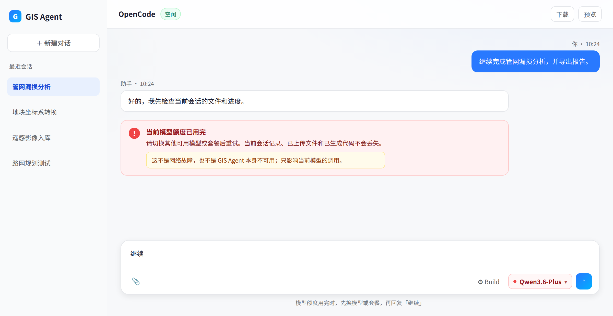
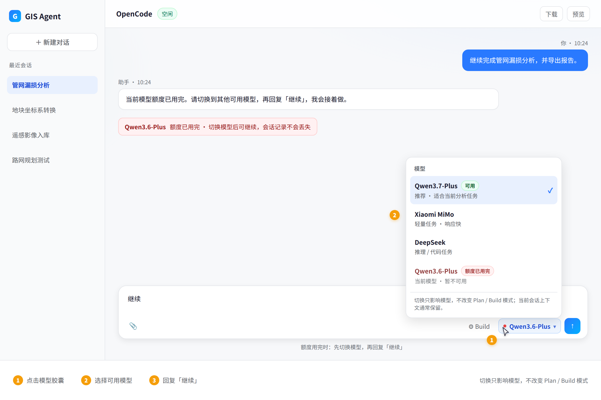

# 额度/套餐用完怎么办

> 先分清"哪个额度用完了"：单个模型、整个套餐、上下文长度、并发数，还是网络/服务故障。
> **应用内能直接切的是"模型"；套餐/额度是账号侧配置，不在对话输入框里。**

## 一、先判断是不是真的"套餐用完"

| 报错/现象 | 更可能是 | 处理 |
| :--- | :------- | :--- |
| `quota exceeded`、`insufficient_quota`、`insufficient balance`、`余额不足`、`当前套餐额度已用完`、`429 Too Many Requests` | 当前模型/套餐的额度或频率用完 | 先换模型；仍不行再换套餐/等重置 |
| `The input is too long`、`Range of input length should be [1, 258048]` | 上下文超长，**不是额度** | 用 `/compact` 压缩或新开对话 |
| `concurrent session limit exceeded` | 并发会话数超限 | 关闭其他会话/等待；联系管理员 |
| `Model not found`、`no running instances available` | 模型服务/部署问题 | 换模型或联系管理员；不是套餐额度 |
| `401`、`403`、`Invalid API key` | 密钥/权限问题 | 联系管理员检查密钥与授权 |
| 网络超时、`502/503/504` | 网络或模型服务暂时不可用 | 重试；持续失败换模型并反馈 |

**只有第一类才是"套餐/额度"问题。** 上下文超长、并发超限、401/404/5xx 换套餐都没用，先按对应列处理。

## 二、应用内先换模型（大多数情况够用）

在对话输入框右下角找到**模型胶囊**（显示当前模型名，如 `Qwen3.6-Plus`），点开选择另一个可用模型，再回复"继续"。

1. 点击模型胶囊（在模式胶囊 `Build/Plan` 右侧）。
2. 在"模型"菜单里选择可用模型，例如 `Qwen3.7`、`Xiaomi MiMo`、`DeepSeek`；以实际列表为准。
3. 回复"继续"或重述上一条需求；同一会话切换，上下文通常保留。
4. 新对话：在发送前先选模型，避免默认模型额度已用完。


*图 1：额度用完提示示意；这不是网络故障，也不是代码写错了。*


*图 2：切换模型示意：点击模型胶囊 → 选择可用模型 → 回复"继续"。*

**注意：**

* **模型胶囊 ≠ 模式胶囊**：模型决定用哪个大模型；模式（Plan / Build）决定能不能写文件。切换模型不会改变 Plan/Build，详见[两种模式](/docs/vibe-code-modes)。
* 切换模型不会自动压缩上下文；如果同时报 `input is too long`，先 `/compact`。
* 同一会话切换，已完成代码、上传文件、对话记录通常都在；如果发现上下文丢了，把上一步的目标和验收标准贴回去。
* 如果模型列表里**所有模型**都提示额度用完，才进入下一节"换套餐"。

## 三、换套餐 / 扩容

**对话界面里通常没有"套餐切换"按钮。** 套餐、额度、计费属于账号/控制台/管理员层，不同部署形态入口不同：

| 部署形态 | 套餐/额度入口 | 处理 |
| :--- | :------------ | :--- |
| 公有云 / SaaS | 账号菜单、控制台、商务/续费页面 | 升级套餐、加购额度，生效后刷新/重新登录 |
| 私有化部署 | 管理员、模型服务配额、商务合同 | 联系管理员调整模型服务配额或套餐 |
| 不确定 | 没有明显入口 | 把报错原文、模型名、时间、账号发给管理员 |

操作顺序：

1. **确认账号/租户**：套餐是挂在账号/租户上的，不是挂在某个会话上。
2. **查用量/套餐页面**（如果当前部署提供）：确认是单模型额度还是整个套餐共用额度。
3. **选择目标套餐/加购额度**：按实际控制台操作；私有化部署由管理员调整。
4. **生效后刷新或重新登录**：有些部署需要重新登录才会刷新套餐状态。
5. **回到原会话回复"继续"**：不要新开对话重述全部需求，除非上下文已经丢了。

如果找不到套餐入口，直接联系管理员，不要反复点击"重试"：重试不会产生额度，只会浪费排查时间。

## 四、切换后怎么继续，不丢现场

* **先在原会话继续**：同一会话切换模型/套餐后，回复"继续"或"从第 N 步继续"。
* **不要删对话**：删了上下文、已生成代码和改过 5 遍的历史都没了；这与[氛围编程](/docs/vibe-code)的"删对话 = 删现场"是同一条纪律。
* **上下文太长时先 `/compact`**：压缩历史后再继续，不要直接开新会话丢现场。
* **重要产物先落盘/导出**：长任务在切换套餐前，先把已生成的 HTML、数据、报告导出或提交，避免切换期间丢失。
* **切换后先验收再继续**：让 AI 先确认当前文件/页面状态，再往下做，避免它重写已完成部分。

可直接复制：

```text
刚才模型额度用完，已完成的部分保留，不要重写。
请先从“XXX”这一步继续：先告诉我当前进度和要改的文件，再执行；
完成后给我改动清单和预览。
```

## 五、氛围编程的额度习惯

* **长任务先看额度**：大重构、批量生成、52 个技能全量跑之前，先确认模型/套餐余量。
* **把任务拆小**：一步一验收，额度中断时损失小，也更容易续上。
* **简单步骤用轻量模型**：改文案、调样式、补一个函数，不必用最贵的模型；复杂分析再切回强模型。
* **先 Plan 再 Build**：在[两种模式](/docs/vibe-code-modes)里先用 Plan 做只读分析，确认方案后再用 Build 执行，减少无效消耗。
* **团队共用套餐要协商**：多人同时跑大任务时，先确认额度分配，避免互相"挤爆"。

## 六、常见误区

* **"是我代码写错了吗？"** 额度报错通常与代码无关；先看报错原文，不要先改代码。
* **"换套餐能解决 `input is too long`"** 不能；那是上下文长度，用 `/compact` 或新对话。
* **"所有模型都换一遍"** 如果所有模型都提示额度用完，通常是套餐共用额度/账户余额，换模型解决不了，找管理员。
* **"切换模型会改 Plan/Build"** 不会；模型和模式是两个独立按钮。
* **"删对话重来最快"** 最慢；现场没了，AI 和技术支持都只能重新猜。
* **"重试几次就有了"** 额度不会因为重试出现；先确认套餐/额度状态。

## 七、给 AI 的一句话

```text
当前模型额度用完，不要重写已完成部分。
我先切换模型/套餐，回来后从“XXX”继续；
请先确认当前进度和文件状态，再执行。
```

如果报错不是额度，而是上下文/并发/网络，直接把原文贴给 AI，并说明"这是额度、上下文还是网络问题"，让它按对应路径处理，不要让它猜。

***

**使用提示：** 先换模型，再换套餐；先保现场，再继续任务。套餐入口不在对话里，找不到就直接找管理员，别把时间花在反复重试上。
